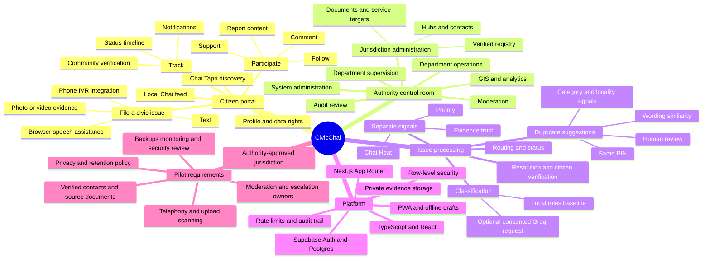
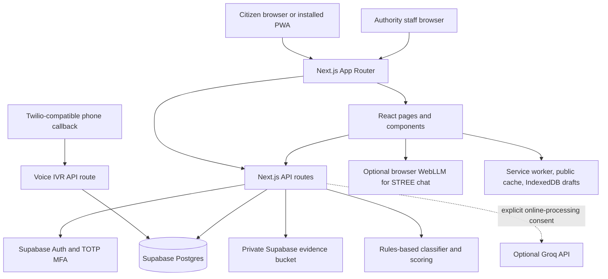

# CivicChai

> **Charcha se Chai. Chai se Change.**
>
> CivicChai is a civic issue reporting and response prototype. It gives residents a shared place to report local problems, see related reports, follow progress, and gives scoped authority staff a workflow for reviewing and acting on those issues.

CivicChai uses the familiar idea of a **chai tapri** as a product metaphor: a local issue becomes a *Charcha* (discussion), community participation contributes *Chai Heat*, and authorities can track an issue through a documented workflow. It is designed as a web app and installable PWA, with browser voice assistance and an optional phone IVR integration.

> **Project status:** prototype for controlled pilot evaluation. External authority setup and operational review are required before accepting real public submissions. CivicChai is not automatically a statutory grievance, appeal, or emergency channel.

## Contents

- [At a glance](#at-a-glance)
- [Project mind map](#project-mind-map)
- [What the application does](#what-the-application-does)
- [Important prototype boundaries](#important-prototype-boundaries)
- [User journeys](#user-journeys)
- [Roles and access](#roles-and-access)
- [Architecture](#architecture)
- [AI, duplicate handling, and scoring](#ai-duplicate-handling-and-scoring)
- [Privacy and security](#privacy-and-security)
- [Offline and PWA behavior](#offline-and-pwa-behavior)
- [Technology](#technology)
- [Quick start](#quick-start)
- [Supabase setup](#supabase-setup)
- [Environment variables](#environment-variables)
- [Application routes](#application-routes)
- [API reference](#api-reference)
- [Data model](#data-model)
- [Repository map](#repository-map)
- [Pilot and production checklist](#pilot-and-production-checklist)
- [SOP coverage](#sop-coverage)
- [Demo walkthrough](#demo-walkthrough)
- [Testing and validation](#testing-and-validation)
- [Troubleshooting](#troubleshooting)
- [Contribution and change guidelines](#contribution-and-change-guidelines)
- [Development notes](#development-notes)
- [Related documentation](#related-documentation)

## At a glance

| Area | Current implementation |
| --- | --- |
| Citizen experience | Issue discovery, filing, comments, support, follow, personal issue tracking, profile and data-rights request entry points |
| Authority experience | Role-specific control room for issue operations, moderation, registry management, audit review, privacy requests, and system readiness |
| Authentication | Supabase Auth in connected mode; browser-only role simulation when running locally without Supabase |
| Staff protection | Every non-citizen role requires Supabase TOTP MFA in connected mode |
| Issue storage | Supabase Postgres with row-level security and server-side service-role workflows; local preview uses temporary in-process stores and browser storage |
| AI | Deterministic rules-based baseline; optional Groq classification only after the citizen opts in to online processing |
| Duplicate candidates | Same-PIN lexical and heuristic matching; suggestions are reviewed by a person, not automatically merged |
| Mapping | Leaflet heatmap with aggregated or approximate geography; exact coordinates are restricted to authorized workflows |
| Phone reporting | Twilio-compatible speech/DTMF IVR route, requiring a configured provider number and callback URL |
| Offline support | Installable app shell, cached public reads, and consent-based local report drafts; drafts require a later authenticated sync |

## Project mind map



## What the application does

### Citizen portal

The citizen experience is organized around local discovery and issue follow-up:

- **Local Chai** shows issues for a selected PIN/locality.
- **Chai Tapri** helps people browse trending and nearby issues.
- **Pour a Chai** opens the issue composer. The citizen supplies a title, description, PIN, locality, category/routing suggestions, and optional evidence.
- **My Charcha** collects issues a person filed, supported, or follows, plus offline drafts awaiting synchronization.
- **Issue detail** displays a public-safe issue summary, discussion, status timeline, and available participation actions.
- **Profile** stores preferences such as locality, preferred PIN, language, notification preferences, and consent settings.
- **Data rights** lets a signed-in person submit an access, correction, erasure, or grievance request. A system administrator records the human review outcome; the application does not automatically export or erase records.

The app's public issue representation redacts common phone numbers, email addresses, long identity numbers, and house-number patterns. It removes original text, reporter identity, evidence links, and precise coordinates from public responses. Redaction is a safeguard, not a guarantee that a free-text description contains no identifying information.

### Authority control room

The control room presents different work areas according to the signed-in role:

- **Moderator:** review reported content, document a decision, and handle appeals.
- **Department operator:** work issues in the assigned department and PIN scope, update workflow status, and add operational notes or resolution evidence.
- **Department supervisor:** oversee a department's queue, assignment, targets, and escalation workflow.
- **Authority administrator:** administer the assigned jurisdiction, verified public registry, cross-department operations, and moderation/audit workflows.
- **System administrator:** view deployment readiness and review data-rights requests. This role is intentionally kept separate from civic case content.
- **Auditor:** read the audit trail for the authorized scope.

The API and database enforce role and scope checks. Hiding a screen in the UI is not the authorization boundary.

### Issue lifecycle

The issue model supports these statuses:

`Filed` → `AI Classified` → `Assigned` → `Acknowledged` → `In Progress` → `Resolved` → `Community Verified` → `Closed`

Additional workflow states include `Under Review` and `Duplicate`. Allowed transitions depend on role. A citizen who filed, supported, or follows a resolved issue can confirm the outcome or dispute it, which reopens the issue to `In Progress`.

## Important prototype boundaries

These distinctions matter when demonstrating the project or preparing a pilot:

| Capability | What is present | Boundary to communicate |
| --- | --- | --- |
| Classification | Rules-based taxonomy, language heuristics, confidence estimate, and citizen confirmation | This is a baseline, not a validated production model. Staff should review classification and routing. |
| Online AI | Optional Groq classification with a configured server key | The composer must collect consent. Complaint text is sent to Groq only for that opted-in request. |
| Duplicate detection | Same-PIN candidate ranking using lexical similarity plus locality, category/department, age, and evidence-presence signals | No embeddings, image matching, or automatic merge. Staff make duplicate decisions; citizens can identify a report as distinct. |
| Chai Heat and priority | Separate community and operational signals | Scores and weights are prototype logic that must be reviewed with a pilot authority before operational use. |
| Authority registry | Jurisdiction, hub, officer, source document, and optional service-target records | The registry starts empty or unverified. Never present invented contacts, laws, officers, or service targets as verified. |
| Browser speech | Browser speech-recognition support where available | Depends on browser support and permission. It is not a retained audio recording. |
| Phone IVR | A Twilio-compatible webhook with Hindi, Marathi, and English choices, consent, speech/DTMF input, PIN, duration, evidence prompt, and review | A live phone channel needs a provider number, public callback URL, credentials, and an operational owner. |
| Offline | Cached app shell/public reads and consent-based local drafts | A draft is not filed while offline. Sync requires a later online session and authenticated submission. Staff operations are online-only. |
| Notifications | In-app notification records and read state | Email, SMS, and web-push delivery are not integrated. |
| Evidence uploads | Type/size checks and private Supabase storage paths | These checks do not scan files for malware. Configure scanning or disable uploads for a pilot until an approved process exists. |
| Data rights | Request capture, review status, response note, and auditability | Fulfillment is a human compliance action; agree identity checks, retention rules, and operating timelines first. |
| Civic/legal guidance | Source-linked registry for verified material | An LLM must not invent legal citations, procedures, staff, or public contacts. The registry must be populated and maintained by the authority. |
| Phone and locality mapping | Live GPS with reverse geocoding, PIN lookup, and signed locality QR codes generated by authority administrators | A QR code or PIN is a convenience, never proof of residency. Altered or unsigned QR codes are rejected. |
| Analytics | Issue queue metrics and approximate/aggregated heatmap | Seed data is synthetic and excluded from live heatmap calculations. Geographic and scoring assumptions need jurisdictional review. |

## User journeys

### File and track an issue

1. The citizen opens `/citizen` and chooses a locality or PIN.
2. They open the composer. The first screen works like a ride-hailing pickup: it detects the device location, the citizen pans the map under a fixed pin, and the PIN code and locality fill in from OpenStreetMap. Both can be changed by hand (a typed PIN moves the map and suggests India Post localities). After confirming the location they describe the issue.
3. The local classifier suggests a category, issue label, language, department, severity, and summary. The citizen can review the proposed information before submission.
4. If online processing is enabled and the citizen opts in, the server may request a Groq classification. Otherwise the local rules result is used.
5. The duplicate checker can suggest similar issues with the same PIN. The citizen can join/support a matching issue or identify a distinct issue; duplicate consolidation remains reviewable.
6. The citizen confirms or corrects the suggested category; the server derives the department from the confirmed category. Filing requires a signed-in account so the report can be tracked and verified. Joining a suggested issue adds the citizen's support and an independent corroborating report.
7. The report receives a document ID such as `CC-401208-2026-XXXXXXXX`, is recorded with an initial status, appears in the citizen's tracking view, and the composer shows a civic education card (department, jurisdiction, verified contacts and next steps).
8. Authorized staff triage, assign, acknowledge, and update status. Status-changing actions are auditable in connected mode. Marking an issue resolved requires a public resolution note (at least 15 characters) or an official HTTPS `.gov.in`/`.nic.in` record.
9. After staff mark an issue resolved, a participating citizen can confirm resolution or report that work remains incomplete.

### Review and resolve an issue

1. Staff sign in through Supabase Auth and complete TOTP MFA.
2. The role and profile scope determine which dashboard and queue data they can access.
3. A department operator or supervisor reviews the issue, assigns or updates it within their scope, and records status, notes, or resolution evidence.
4. The status event and action audit record provide an operational trail.
5. A citizen who participated in the issue can verify or dispute the reported outcome.

### Submit a phone report

The IVR route begins with language selection and a consent choice for speech-to-text. A caller can provide speech or use DTMF category choices, enter a PIN, describe duration, indicate whether evidence is available later, then hear and confirm a summary. The webhook validates the Twilio request signature and stores the call session in Supabase. If provider configuration or the connected database is missing, the route directs callers to the web portal.

## Roles and access

| Role key | Display name | Main responsibility | MFA in connected mode |
| --- | --- | --- | --- |
| `citizen` | Citizen | File, discuss, support, follow, and track issues | No staff MFA requirement |
| `moderator` | Moderator | Review content reports and appeals | Required |
| `department_operator` | Department operator | Process scoped department cases | Required |
| `department_supervisor` | Department supervisor | Supervise a department queue and assignments | Required |
| `authority_admin` | Authority administrator | Manage an authorized jurisdiction and its verified registry | Required |
| `system_admin` | System administrator | Platform readiness and data-rights operations | Required |
| `auditor` | Auditor | Read-only governance and audit review | Required |

Connected-mode authorization reads the role from the protected Supabase `profiles` row, not editable user metadata. Department and authority records are scoped by the profile's department and/or PIN. The schema also uses row-level security (RLS), column grants, and server-only operations for sensitive changes.

## Architecture



### Request and data boundaries

- The browser uses the Supabase publishable key for Auth and approved client reads. The server-only service-role key is never exposed to browser code.
- API routes validate the current Supabase user and read the protected profile for role and scope. Non-citizen actions require an MFA-authenticated Supabase session (AAL2).
- Sensitive issue operations use server-side workflows and database functions. Migrations `003_pilot_hardening.sql` and `004_staff_mfa_rls.sql` restrict direct staff table writes, require staff MFA in database policies, and record issue actions/audit events transactionally.
- Public feeds use safe columns and a server-side public projection. Exact coordinates, original report text, reporter IDs, and private evidence paths are excluded from public responses.
- Rate-limited routes use a shared database-backed limiter in connected deployments. If shared request protection is unavailable, protected operations fail closed.
- The browser-only local preview is deliberately not a production identity system or durable database.

## AI, duplicate handling, and scoring

### Classification

The local classifier in `lib/ai.ts` uses a small keyword taxonomy for Public Lighting, Sanitation, Roads & Potholes, Water Supply, Drainage, Traffic, and Public Health, with a General civic issue fallback. It estimates language, issue type, location/PIN when present, severity, confidence, and a suggested department. Location and classification remain subject to citizen/staff review.

The optional Groq path is server-side and has a configured model name (`GROQ_MODEL`, default `llama-3.3-70b-versatile`). It is used only when `onlineConsent` is true. The result is constrained to the known category list and falls back to local rules on request or parsing failure. This path is not retrieval-augmented and does not supply verified government facts.

The STREE chat in `components/stree-chat.tsx` is a separate feature. It uses local pattern-based civic guidance by default; a visitor can opt into downloading and running the optional WebLLM model on a WebGPU-capable browser. It does not call the Groq classification endpoint.

### Duplicate suggestions

`lib/scoring.ts` first requires the same six-digit PIN, then ranks candidates using:

- lexical Jaccard similarity over normalized words (including common Hindi/Marathi stop words);
- locality match or presence;
- category/department match;
- report age; and
- whether both reports include evidence.

Candidates below the implementation's 60% score threshold are omitted. Results are ranked and limited to three. A score of 75% or higher is treated as a strong suggestion by the analyze route. These numbers are heuristic signals, not calibrated probabilities. The system does not automatically reject a report or merge issues based on a model score.

### Chai Heat, priority, and trust

These values have different meanings and are stored separately:

- **Chai Heat** summarizes community participation through supporter/report activity.
- **Priority** estimates operational urgency and impact.
- **Evidence trust** describes confidence signals for a report; it is not a rating of the citizen.

The initial deterministic priority calculation weights these factors:

| Factor | Weight |
| --- | ---: |
| Severity | 25% |
| Community support | 25% |
| Independent reports/corroboration | 15% |
| Persistence | 10% |
| Geographic impact | 10% |
| Evidence presence/quality signal | 10% |
| SLA context | 5% |

The score maps to `Critical` (82–100), `High` (65–81), `Moderate` (40–64), or `Low` (0–39). The connected database recalculates community signals when supports, reports, or comments change. Its current Chai Heat calculation is based on supporter and report counts and is capped at 100; local preview behavior is simplified. Treat these formulas as prototype defaults, not approved public policy.

The report trust score combines evidence, whether a location was supplied, corroboration, report-text detail, and an anomaly penalty. It must never be used as a citizen reputation or to deny intake.

## Privacy and security

The code includes these safeguards:

- Supabase Auth and protected profile-based role assignment in connected mode.
- TOTP MFA for all staff roles, enforced in both API authorization and database row-level policies.
- RLS policies and restricted column grants in the Supabase migrations.
- Server-only service credentials for privileged operations; do not add a `NEXT_PUBLIC_` prefix to secret keys.
- Private evidence storage scoped to the uploading account and authorized issue staff.
- Public text redaction and removal of exact coordinates, original text, reporter identity, and private evidence URLs from public projections.
- Audit events for administrative and issue workflow actions.
- Rate limiting for issue creation, comments, AI analysis, evidence uploads, and moderation/content reports.
- HTTPS-only source URL validation for registry records; only `.gov.in` or `.nic.in` sources may be marked verified.
- Security headers configured in `next.config.mjs`.
- Twilio request-signature validation for the IVR webhook.
- Production issue and phone intake stay disabled until explicitly approved; evidence uploads stay disabled until the file-handling workflow is ready.

Operational protections still need owners and services before a real pilot: malware scanning, backups and restore drills, monitoring and alerting, incident response, privacy/retention policy, authority-approved response procedures, and independent security review. The detailed pilot requirements are summarized in this README and in [Supabase setup](supabase/README.md).

## Offline and PWA behavior

The PWA manifest starts at `/citizen`; the service worker caches a small application shell, static assets, and selected public issue/registry reads. When the network is unavailable it can return cached public data or an empty offline response.

A citizen may explicitly consent to save an issue draft in browser IndexedDB. Drafts remain on the device and are shown as pending; they are submitted only after connectivity returns and an authenticated sync succeeds. The UI must not claim that an offline draft has been filed. Private staff operations and telephony submission are online-only.

## Technology

| Layer | Technology |
| --- | --- |
| Framework | Next.js 16 App Router |
| UI | React 19, TypeScript, Tailwind CSS 4 |
| Components and icons | Base UI, shadcn setup, Lucide React |
| Authentication and database | Supabase Auth, Postgres, RLS, SQL functions and migrations |
| Evidence | Supabase Storage private bucket |
| Maps | Leaflet and React Leaflet; configurable map tiles |
| Local model | `@mlc-ai/web-llm` in the browser where WebGPU is available |
| Optional hosted model | Groq chat completion API for consented classification |
| PWA | Web app manifest, service worker, browser IndexedDB drafts |
| Hosting configuration | `vercel.json` is included |

## Quick start

### Requirements

- Node.js compatible with the Next.js version in `package.json`.
- `pnpm` (preferred in the repository) or `npm`.
- A modern browser for the citizen and staff interfaces. WebGPU, microphone, and service-worker support vary by browser and device.

### Local UI preview

No Supabase project is required for a local UI preview. Ensure Supabase values are **unset or blank** in `.env.local`; the placeholder values in `.env.example` are examples and must not be used as real credentials.

```bash
cd Rodgers-SIH
cp .env.example .env.local
# Edit .env.local and leave Supabase URL and key values blank for local preview.
pnpm install
pnpm dev
```

Open [http://localhost:3000](http://localhost:3000). The login screen offers browser-only demo roles. These sessions, in-memory issue data, and local browser storage are for UI review only; they are not secure authentication or durable storage. A clean local preview starts with an empty issue feed.

Use npm if preferred:

```bash
npm install
npm run dev
```

## Supabase setup

Use a connected Supabase project to exercise durable authentication, database-backed workflows, MFA, evidence storage, registry, audit, and role scoping.

1. Create a Supabase project and copy its project URL and publishable (or legacy anon) key.
2. Apply the SQL migrations in order:
   - `supabase/migrations/001_init.sql`
   - `supabase/migrations/002_civicchai_platform.sql`
   - `supabase/migrations/003_pilot_hardening.sql`
   - `supabase/migrations/004_staff_mfa_rls.sql`
   - `supabase/migrations/005_pilot_workflow.sql`
   - `supabase/migrations/006_anonymous_handles.sql`
   - `supabase/migrations/007_service_area_pins.sql`

   `supabase/schema.sql` is also provided as a consolidated schema for a fresh SQL Editor import. Prefer either the ordered migrations or the consolidated schema, not both on the same database.
3. Optionally run `supabase/seed.sql` to insert clearly labeled synthetic issues for a connected demo. No real officers, public contacts, laws, or SLAs are seeded as verified.
4. Set the public Supabase URL/publishable key and the server-only URL/service-role key in `.env.local` or deployment secrets.
5. Create demo Auth users and profiles with:

   ```bash
   pnpm run seed:demo-users
   ```

   The script requires `SUPABASE_URL` and `SUPABASE_SERVICE_ROLE_KEY`. It is disabled in production unless `ALLOW_DEMO_USER_SEED=1` is explicitly set. Never enable this for a public deployment.
6. Start the app. Demo logins are on by default: the demo accounts appear on `/login` and demo staff skip MFA for testing. With `NEXT_PUBLIC_CIVICCHAI_DEMO_MODE=false`, staff demo accounts enroll in TOTP MFA on first sign-in. Rerunning the seed script resets demo passwords and removes any authenticator enrolled on a demo account.
7. Before accepting real submissions, populate and verify the authority registry and complete the pilot and production checklist in this README.

### Demo identities

All demo users use the shared password `CivicChai!2026` in the local preview and in the seeding script. The account list is maintained in `lib/roles.ts` and `scripts/seed-demo-users.mjs`.

| Role | Email |
| --- | --- |
| Citizen | `citizen@civicchai.local` |
| Moderator | `moderator@civicchai.local` |
| Department operator | `operator@civicchai.local` |
| Department supervisor | `supervisor@civicchai.local` |
| Authority administrator | `authority@civicchai.local` |
| System administrator | `system-admin@civicchai.local` |
| Auditor | `auditor@civicchai.local` |

Change or remove demo identities before exposing a connected environment beyond a controlled demonstration. The database seed adds synthetic issues separately; the account-seeding script does not seed real authority data.

## Environment variables

Copy `.env.example` as a reference, then supply only the values for integrations you are using. Keep secret values out of source control.

| Variable | Required for | Notes |
| --- | --- | --- |
| `NEXT_PUBLIC_SUPABASE_URL` | Connected browser and app | Supabase project URL; public by design. |
| `NEXT_PUBLIC_SUPABASE_PUBLISHABLE_KEY` | Connected browser and app | Supabase publishable key. Legacy anon-key variable names are also accepted by the client. |
| `SUPABASE_URL` | Server workflows and seed script | Supabase project URL for server-side clients. |
| `SUPABASE_SERVICE_ROLE_KEY` | Server workflows and account seeding | Secret. Server-side only; grants privileged database access. |
| `GROQ_API_KEY` | Optional online AI classification | Secret. Only used for a request where online processing consent is true. |
| `GROQ_MODEL` | Optional online AI classification | Defaults to `llama-3.3-70b-versatile`. |
| `APP_BASE_URL` | Phone IVR callback | Public base URL used to construct the Twilio webhook callback. |
| `NEXT_PUBLIC_APP_URL` | App/IVR base URL fallback | Defaults in the example to `http://localhost:3000`; use the public HTTPS origin for a deployed IVR. |
| `NEXT_PUBLIC_SITE_URL` | Canonical, sitemap, and social metadata base URL | Set this to the deployed public HTTPS origin (for example, `https://civicchai.example`). Vercel's production URL and `NEXT_PUBLIC_APP_URL` are used as fallbacks. |
| `NEXT_PUBLIC_MAP_TILE_URL` | Map tiles | Tile URL template; OpenStreetMap is shown in the example. |
| `NOMINATIM_URL` | Optional live-location lookup | Reverse geocoding (device location → PIN and locality) and PIN centring. Defaults to the public OpenStreetMap Nominatim service, which allows light use only; use your own instance for a busy pilot. |
| `PINCODE_API_URL` | Optional PIN validation | Post-office localities for a PIN. Defaults to `https://api.postalpincode.in`. |
| `NEXT_PUBLIC_MAP_ATTRIBUTION` | Map attribution | Attribution HTML shown with the map. Keep provider attribution requirements. |
| `TWILIO_AUTH_TOKEN` | Phone IVR | Secret used to validate incoming Twilio signatures. Configure the provider's webhook URL to `/api/voice/ivr`. |
| `CIVICCHAI_PUBLIC_INTAKE_ENABLED` | Pausing issue and phone intake | Intake (sign-in required, rate limited) is on by default. Set to `false` to pause filing, for example during maintenance or before the authority approves go-live. Accepts `true`/`false`, `1`/`0`, `yes`/`no`. |
| `CIVICCHAI_EVIDENCE_UPLOADS_ENABLED` | Production evidence uploads | Set to `true` only after an approved malware scanning or file-handling workflow is active. Production defaults to disabled. |
| `NEXT_PUBLIC_CIVICCHAI_DEMO_MODE` | Demo logins for testing | On by default: `/login` lists the seeded `@civicchai.local` accounts as one-tap sign-ins and those demo staff accounts skip TOTP MFA. Real staff accounts still require MFA. Set to `false` before accepting real reports. |
| `NEXT_PUBLIC_CIVICCHAI_OPERATOR_NAME`, `NEXT_PUBLIC_CIVICCHAI_GRIEVANCE_OFFICER`, `NEXT_PUBLIC_CIVICCHAI_GRIEVANCE_EMAIL` | Privacy notice and community guidelines | Published on `/privacy` and `/community-guidelines`. Until set, the pages state that the details must be published before real reports. |
| `QR_SIGNING_SECRET` | Optional | Dedicated HMAC key for locality QR codes; defaults to a key derived from the service role key. Changing it invalidates printed codes. |
| `ALLOW_DEMO_USER_SEED` | Exceptional production seeding only | Must be `1` to override the script's production guard. Avoid enabling in public environments. |

Do not commit `.env.local`, service-role keys, provider tokens, or real citizen data.

## Application routes

| Route | Purpose |
| --- | --- |
| `/` | Public landing page and feature overview |
| `/about` | Product background |
| `/how-it-works` | Issue workflow explanation |
| `/citizen` | Citizen feed, filing, personal tracking, and profile areas |
| `/chai-tapri` | Community issue discovery |
| `/issues/[id]` | Issue detail and discussion |
| `/control-room` | Role-specific authority dashboard |
| `/login` | Sign-in and local demo role selection |
| `/mfa` | Staff TOTP enrollment/challenge |
| `/voice-agent` | AI call agent: a simulated phone call that asks the SOP questions by voice (problem, place/PIN, duration, proof), reads the complaint back and files it on "yes". `?mode=form` opens the step-by-step voice form. Script: `lib/voice-call.ts`. |
| `/offline` | Offline state and recovery guidance |
| `/q/[token]` | Signed locality QR landing page; verified codes open a pre-filled report |
| `/knowledge` | Verified hubs, officers, documents and service targets for a PIN |
| `/present` | Pitch deck (13 slides, keyboard/swipe, full screen, PDF export); linked from the landing page |
| `/privacy` | Privacy notice (DPDP-oriented, mapped to actual data flows) |
| `/community-guidelines` | Acceptable use, moderation and appeal process |

## API reference

All routes are Next.js route handlers under `app/api`. Authentication and role requirements are enforced per route; public-safe endpoints intentionally return redacted/limited data. See the route handler for exact request and response fields.

| Endpoint | Methods | Purpose / access summary |
| --- | --- | --- |
| `/api/health` | `GET` | Basic application health information. |
| `/api/system/health` | `GET` | System/database readiness details; system administrator only. |
| `/api/issues` | `GET`, `POST` | Filter issue feed; create a report with six-digit PIN and locality. |
| `/api/issues/[id]` | `GET` | Fetch one issue; public projection for citizens, scoped detail for staff. |
| `/api/public/issues` | `GET` | Public-safe issue feed for PWA clients. |
| `/api/public/issues/[id]` | `GET` | Public-safe issue detail. |
| `/api/public/trending` | `GET` | Public trending issue data. |
| `/api/public/registry` | `GET` | Verified public authority registry data. |
| `/api/issues/[id]/comments` | `GET`, `POST` | Read and add issue discussion comments; posting requires sign-in. |
| `/api/issues/[id]/support` | `GET`, `POST` | Read current support state/count and support an issue. |
| `/api/issues/[id]/follow` | `GET`, `POST`, `DELETE` | Read, add, or remove an issue follow. |
| `/api/issues/[id]/timeline` | `GET` | Read the issue status timeline. |
| `/api/issues/[id]/status` | `PATCH` | Role-scoped status/assignment operation with audit trail. |
| `/api/issues/[id]/duplicates` | `GET`, `POST` | Review duplicate candidates and record a duplicate decision. |
| `/api/issues/[id]/verification` | `POST` | Participating citizen confirms or disputes a resolved issue. |
| `/api/issues/[id]/evidence` | `GET` | Authorized access to private issue evidence. |
| `/api/evidence` | `POST` | Upload private image/video evidence (up to 4 MB per item). |
| `/api/issues/[id]/report` | `POST` | Submit a moderation/content report. |
| `/api/me/issues` | `GET` | List the signed-in citizen's filed/supported/followed issues. |
| `/api/me/moderation-reports` | `GET`, `POST` | Read or submit reports made by the signed-in user. |
| `/api/moderation` | `GET` | Moderator queue. |
| `/api/moderation/[id]` | `PATCH` | Record a moderation decision. |
| `/api/ai/analyze` | `POST` | Classify text, calculate signals, and return duplicate candidates; rate limited. |
| `/api/gis/heatmap` | `GET` | Return aggregated issue heatmap data and filters. |
| `/api/registry` | `GET`, `POST` | Read or manage jurisdiction-scoped hubs, officers, documents, and targets; authority administrator only. |
| `/api/profile` | `GET`, `PATCH` | Read/update the signed-in user's profile and preferences. |
| `/api/notifications` | `GET`, `PATCH` | Read notifications and mark them as read. |
| `/api/privacy-requests` | `GET`, `POST`, `PATCH` | Submit/read data-rights requests; system administrator handles review updates. |
| `/api/audit` | `GET` | Read scope-authorized audit events; auditor or authority administrator. |
| `/api/voice/ivr` | `POST` | Twilio-compatible signed voice/DTMF callback. |
| `/api/qr` | `GET`, `POST` | Verify a locality QR token; authority administrators create signed QR codes for their PIN. |
| `/api/analytics` | `GET` | SOP KPIs (median time to acknowledge/assign/resolve, duplicate reduction, evidence rate), department and channel breakdowns, repeat issues and support-spike flags; supervisor, authority administrator or auditor, scoped. |
| `/api/geo/reverse`, `/api/geo/pincode` | `GET` | Coordinates to PIN/locality and PIN to localities and map centre. |
| `/api/public/map` | `GET` | Public community map cells generalized to about 1 km. |

## Data model

The canonical Postgres schema and access policies live in `supabase/migrations/`. Main entity groups are:

| Group | Tables | Purpose |
| --- | --- | --- |
| Identity and access | `profiles`, Supabase Auth users | Product role, display name, locality, PIN, department, language, consent and notification preferences. |
| Taxonomy and jurisdiction | `categories`, `departments`, `jurisdictions` | Civic issue categories and authority area hierarchy. |
| Issue and intake | `issues`, `issue_reports`, `issue_evidence` | Canonical issue, source report(s), classification/scoring metadata, consent, and private evidence references. |
| Participation | `issue_supports`, `issue_follows`, `issue_comments` | Community support, personal follow state, and moderated discussion. |
| Workflow and review | `status_events`, `issue_official_notes`, `duplicate_links`, `moderation_reports` | Status history, staff notes, duplicate decisions, content reports, and appeals. |
| Authority reference | `authority_hubs`, `officer_registry`, `official_documents`, `sla_targets` | Source-backed jurisdiction contacts, routing information, public guidance, and optional service targets. |
| Governance | `audit_logs`, `data_rights_requests`, `notifications` | Oversight, citizen rights workflow, and in-app updates. |
| Platform operations | `voice_sessions`, `api_rate_limits` | Server-only IVR session state and shared request throttling. |

An issue stores a public-facing document ID and description, original/normalized text, category and department, jurisdiction labels, status, priority and trust factors, Chai Heat, counts, channel/model metadata, evidence presence, and timestamps. Access policies intentionally do not make every column public. The full relationships and constraints are defined in SQL rather than duplicated here.

### Database setup files

- `supabase/migrations/001_init.sql`: core identity, taxonomy, issues, comments, supports, and basic audit schema.
- `supabase/migrations/002_civicchai_platform.sql`: role/scope helpers, platform entities, RLS, storage, scoring and workflow functions.
- `supabase/migrations/003_pilot_hardening.sql`: hardened server-side issue actions, role transition checks, geographic scope fields, and schema version marker.
- `supabase/migrations/004_staff_mfa_rls.sql`: requires MFA for staff data access through both app routes and direct database API requests.
- `supabase/migrations/007_service_area_pins.sql`: lets staff cover several PIN codes (`profiles.service_pins`), enforced in API scope checks and database functions; gives the demo staff the demo PINs 401208–401211; sets schema version 7.
- `supabase/migrations/006_anonymous_handles.sql`: gives every profile a stable anonymous public handle (for example `KadakKulhad-3F9A`), stamps comments with the author's handle, stops defaulting private names to the email prefix, and sets schema version 6.
- `supabase/migrations/005_pilot_workflow.sql`: adds the `Municipal Operations` fallback department, accepts a public resolution note in place of a mandatory official URL, records `closed_at`, and sets schema version 5 (checked by `/api/health`).
- `supabase/schema.sql`: consolidated fresh-project schema.
- `supabase/seed.sql`: synthetic demo jurisdictions/issues only.

## Repository map

```text
Rodgers-SIH/
├── app/                         Next.js pages and API route handlers
│   ├── api/                     REST-style route handlers
│   ├── citizen/                 Citizen portal route
│   ├── control-room/            Authority dashboard route
│   ├── issues/[id]/             Issue detail route
│   ├── login/ and mfa/           Authentication screens
│   ├── voice-agent/              Browser voice reporting route
│   └── globals.css               Global design tokens and styles
├── components/
│   ├── auth/                    Sign-in and MFA screens
│   ├── brand/                   Issue cards, badges, timeline, heat meter
│   ├── citizen/                 Citizen app, composer, views, voice flow
│   ├── gov/                     Control room, role dashboards, map views
│   ├── landing/                 Landing and product overview sections
│   ├── stree-chat.tsx            STREE civic co-pilot widget
│   └── ui/                      Shared UI primitives
├── lib/                         Domain logic and service clients
│   ├── ai.ts                    Local classifier and optional Groq client
│   ├── api-auth.ts               Request identity, role and MFA checks
│   ├── issues.ts                 Issue queries, creation, and workflow helpers
│   ├── scoring.ts                Priority, trust, and duplicate heuristics
│   ├── privacy.ts                Public text redaction/projection
│   ├── offline-*.ts              Public cache and local draft queue
│   ├── roles.ts                  Product roles and role helpers
│   └── supabase.ts               Browser/server Supabase clients
├── public/                      Icons, PWA manifest, service worker, images
├── scripts/                     Demo Auth user seeding script
├── supabase/                    Migrations, consolidated schema, seed data
├── .env.example                 Environment variable reference
├── package.json                 Scripts and dependencies
└── README.md                     This document
```

## Pilot and production checklist

Before a live pilot, the responsible authority and deployment team should:

1. Apply all seven migrations and confirm `/api/health` reports ready and `/api/system/health` reports a connected database.
2. Use individual accounts with least-privilege role, department, and jurisdiction scopes. Change or remove shared demo credentials. Enroll staff in TOTP MFA.
3. Populate and verify official jurisdiction, hub, department, officer/contact, legal-document, and optional service-target records from approved sources. Keep records unverified until reviewed.
4. Approve privacy notices, consent language, data-retention/deletion rules, identity checks for data-rights requests, and the owners who fulfill those requests.
5. Define moderation coverage, duplicate review, issue assignment, escalation, resolution verification, incident response, and service-target procedures.
6. If phone intake is in scope, configure and test the Twilio number, HTTPS callback, `APP_BASE_URL`, `TWILIO_AUTH_TOKEN`, consent script, transcription, DTMF fallback, correction, and final readback.
7. Connect malware scanning or disable evidence uploads until an approved file-handling workflow exists. Current validation checks declared type, file signature, and a 4 MB limit; it is not malware scanning.
8. Configure backups, verify a restore, monitor application/database errors, name an incident contact, and complete an independent security review.
9. Run jurisdiction-approved acceptance sessions for each role, out-of-scope access, redaction, accessibility, real mobile/offline sync, voice/DTMF, duplicate merge/unmerge, status evidence, notifications, and lost-device/data-rights scenarios.
10. State clearly which official grievance and emergency channels remain authoritative. Do not describe CivicChai as a statutory grievance or appeal channel unless the responsible authority formally approves that use and its integrations.

The detailed coverage table and pilot boundaries are in this README and [Supabase setup](supabase/README.md).

Issue and phone intake are on by default and can be paused with `CIVICCHAI_PUBLIC_INTAKE_ENABLED=false`. Evidence uploads stay disabled in production unless `CIVICCHAI_EVIDENCE_UPLOADS_ENABLED=true`; enable them only after an approved malware-scanning or file-handling workflow is operating.

## SOP coverage

The product is aligned to the two-portal model in `CivicChai_PS2_Master_SOP_v2_Two_Portals.pdf`.

| SOP area | Application surface | Implementation status |
| --- | --- | --- |
| Citizen Portal | `/citizen`, `/chai-tapri`, `/issues/[id]` | Implemented |
| Complaint composer | Citizen composer, `/api/issues`, `/api/ai/analyze` | Implemented with local baseline classification |
| Text and voice intake | Composer, browser voice agent, `/api/voice/ivr` | Implemented; provider setup required for phone |
| Duplicate detection | Composer suggestions and control-room duplicate review | Implemented as human-reviewed heuristics |
| Community participation | Support, follow, comments, reports, moderation | Implemented |
| Chai Heat | Issue cards, issue metrics, scoring helpers | Implemented as prototype scoring |
| Government dashboard | `/control-room` and role dashboard | Implemented with role-specific views and navigation |
| Department routing | PIN/department scope and issue APIs | Implemented; authority registry must be configured |
| GIS/hotspots | GIS dashboard and `/api/gis/heatmap` | Implemented with aggregate/approximate data |
| Registry and legal education | Authority registry APIs and views | Implemented; records remain unverified until sourced |
| Audit and compliance | `/api/audit`, status events, moderation and privacy records | Implemented in connected mode |
| Locality QR (§3.1, §15) | Registry → Locality QR codes, `/q/[token]` | Implemented with signed, tamper-evident codes |
| KPIs and Chai Heat integrity (§2.2, §17) | Control room Analytics, `/api/analytics` | Implemented; spike flags are for human review only |
| Complaint report document (§4) | `/issues/[id]` Print / Save as PDF | Implemented |
| Knowledge / Documents (§20) | `/knowledge` | Implemented from the verified registry |
| Notice, community rules, grievance contact (§14, §22) | `/privacy`, `/community-guidelines` | Implemented as templates; contacts come from deployment settings and need legal review |
| Offline support | PWA shell, public cache, IndexedDB drafts | Implemented with online authenticated sync required |
| Accessibility and governance | Semantic controls, labels, explicit consent and review paths | Requires deployment-specific acceptance testing |

The SOP remains the source of product policy. Code behavior is a prototype implementation and must not be treated as an authority's approved process without review.

## Demo walkthrough

### Local browser-only demo

1. Start the app with Supabase variables blank.
2. Open `/login`.
3. Select one of the demo accounts. All local demo accounts use `CivicChai!2026`.
4. Sign in. Citizen accounts open `/citizen`; government roles open `/control-room`.
5. Use **Sign out** before switching roles. The local session is stored under `civicchai_demo_session`.
6. To reset the local session, sign out or remove that browser storage key from developer tools.

Each government demo role is intentionally different:

| Account | Landing work surface | Demonstration focus |
| --- | --- | --- |
| `citizen@civicchai.local` | Citizen Portal | File, support, follow and track an issue |
| `moderator@civicchai.local` | Moderation desk | Review a report and record a decision |
| `operator@civicchai.local` | Department queue | Work lighting issues in PIN `401208` |
| `supervisor@civicchai.local` | Department operations | Review department analytics and assignments |
| `authority@civicchai.local` | Jurisdiction control room | Review cross-department operations and registry |
| `system-admin@civicchai.local` | System administration | Review readiness and privacy requests |
| `auditor@civicchai.local` | Audit and compliance | Inspect read-only governance records |

The local preview is suitable for UI and presentation walkthroughs only. It does not provide secure identity, shared data, durable issue persistence, MFA, or production authorization.

### Connected Supabase demo

1. Apply the database migrations and seed synthetic issue data.
2. Set both public and server Supabase variables.
3. Run `pnpm run seed:demo-users`.
4. Sign in with a demo account.
5. Complete TOTP enrollment for any non-citizen account.
6. Use the authority administrator account to create or verify the demo jurisdiction registry.
7. Use the citizen account to file a synthetic issue in PIN `401208`.
8. Review the issue as the operator or supervisor, then inspect the resulting status and audit trail as the auditor.

Do not mix local-browser and connected-mode expectations. Local demo sessions use request headers generated by the app's local demo path; connected requests use Supabase bearer tokens and protected profile records.

## Testing and validation

The repository provides a TypeScript check, a production build, and a unit test suite (`tests/`) for the domain logic: multilingual classification, language detection, priority/trust/Chai Heat scoring, duplicate geographic safety and hard negatives, public redaction, heatmap generalization and timeline states. The tests use Node's built-in test runner with TypeScript type stripping (Node 22.18 or later). There is no committed browser, accessibility or security test runner yet.

Run the available checks from `Rodgers-SIH/`:

```bash
pnpm typecheck
pnpm test
pnpm build
pnpm dev
```

Equivalent npm commands are available:

```bash
npm run typecheck
npm run build
npm run dev
```

### Manual acceptance matrix

Before a demo or pilot, verify at least:

| Test | Expected result |
| --- | --- |
| Local citizen sign-in | Opens the citizen portal and does not expose staff tools |
| Local moderator sign-in | Opens only moderation work and uses moderator copy |
| Local operator sign-in | Opens the department queue and shows department-scoped behavior |
| Local supervisor sign-in | Opens department operations and analytics |
| Local authority sign-in | Opens jurisdiction operations and registry access |
| Local system-admin sign-in | Opens system/privacy operations, not civic case queues |
| Local auditor sign-in | Opens read-only audit/compliance work |
| Connected staff sign-in without AAL2 | Protected APIs return an MFA-required response |
| Citizen public issue view | Does not expose reporter identity, raw text, private evidence or exact coordinates |
| Out-of-scope staff issue | API rejects the action even if a user manually calls the endpoint |
| Duplicate suggestion | Suggests candidates without automatically merging or suppressing intake |
| Resolution verification | Participating citizen can confirm or dispute a resolved issue |
| Evidence upload | Enforces allowed media type and size; private path is not public |
| Offline draft | Clearly remains a draft and is not reported as filed |
| Registry record | Unverified or unsourced authority records are not presented as verified |
| Demo seed | Creates synthetic accounts/data only and is blocked in production by default |

## Troubleshooting

### The app always opens the same dashboard

Confirm that the selected account is actually changing and that the previous local session is cleared. Sign out before choosing another account. In connected mode, the dashboard role comes from the `profiles.role` value, not from editable Auth metadata. Run the seed script again if a profile is missing or has the wrong role.

### `Supabase accepted the sign-in, but ... role profile`

Check that all migrations were applied, the Auth user exists, and a matching row exists in `profiles`. Then run:

```bash
pnpm run seed:demo-users
```

Use the same Supabase project URL and service-role key for the seed script and the app.

### Staff API returns an MFA-required response

This is expected until the staff user enrolls in or verifies TOTP MFA. Open `/mfa`, complete the authenticator setup, and sign in again. Do not bypass the AAL2 check in application code.

### Moderator sign-in shows a code field but no setup QR

The moderator account already has a verified TOTP factor. Open the authenticator app previously enrolled for that account and enter its current six-digit code. Supabase only returns the setup QR and secret when enrolling a new factor; rerunning `pnpm run seed:demo-users` does not clear existing MFA factors. If the enrolled app is no longer accessible, have the Supabase project administrator reset that account's factor through the approved account-recovery process.

### The issue feed is empty

An unconfigured local preview intentionally starts empty. For a connected demo, run `supabase/seed.sql` after the migrations. Confirm the selected PIN/locality and check the browser network response for `/api/public/issues`.

### The map has no tiles

Check `NEXT_PUBLIC_MAP_TILE_URL`, `NEXT_PUBLIC_MAP_ATTRIBUTION`, browser connectivity, and the tile provider's usage policy. Map tiles are an external service and are not bundled with the application.

### Groq classification is unavailable

This is expected when `GROQ_API_KEY` is blank or the citizen did not consent to online processing. The local classifier remains the fallback. Never move `GROQ_API_KEY` into a `NEXT_PUBLIC_` variable.

### Phone IVR redirects to the web portal

Verify `APP_BASE_URL`, `NEXT_PUBLIC_APP_URL`, `TWILIO_AUTH_TOKEN`, the provider webhook URL, and HTTPS deployment. The route also requires a connected database for persistent voice session state.

### Evidence upload fails

Confirm the user is authenticated, the file is an allowed image/video type, and it is within the configured size limit. A successful upload still requires an approved malware-scanning and retention process before production use.

## Contribution and change guidelines

When changing a feature:

1. Read the route, component, domain helper, and relevant migration before editing.
2. Preserve the two-portal boundary and role least privilege.
3. Keep public projections separate from private issue/report/evidence data.
4. Update all related surfaces: UI, API authorization, domain types, SQL migration/schema, seed data, and documentation.
5. Keep deterministic fallbacks available when optional AI, maps, WebGPU, telephony, or network services are unavailable.
6. Treat AI output as a suggestion. Do not silently convert a model result into a legal, identity, routing, or enforcement decision.
7. Add auditability to staff actions and explicit error messages to user-facing failures.
8. Keep demo and seed data synthetic and visibly labeled.
9. Run `pnpm typecheck` and `pnpm test`; run `pnpm build` when changing routes, environment handling, or server/client boundaries.
10. Do not commit `.env.local`, service-role keys, provider tokens, real citizen data, private evidence, or unverified official claims.

### Database change rule

For database-backed changes, update the next ordered migration and the consolidated `supabase/schema.sql` when the schema is intended to be reusable from a fresh project. Keep `supabase/seed.sql` safe to rerun and synthetic. Explain any data migration or backward-compatibility requirement in the pull request.

### Pull request review questions

- Does every new endpoint authenticate and authorize independently?
- Is the role read from the protected profile rather than client-controlled metadata?
- Are PIN, department, and jurisdiction scopes enforced server-side?
- Could a public response reveal identity, raw complaint text, exact location, or private evidence?
- Is online processing consent captured before external AI transmission?
- Can a citizen still report a genuinely distinct issue?
- Are duplicate, priority, trust, and Chai Heat signals kept conceptually separate?
- Are errors visible and actionable rather than silently swallowed?
- Does the documentation describe any new setup or operational responsibility?

## Development notes

Available package scripts:

```bash
pnpm dev                 # Start the Next.js development server
pnpm build               # Build the application
pnpm start               # Serve a production build
pnpm typecheck            # Run TypeScript without emitting files
pnpm test                 # Run the domain-logic unit tests
pnpm seed:demo-users      # Provision demo Supabase Auth users (requires server credentials)
```

`pnpm test` covers pure domain logic only; integration, accessibility and security testing remain manual acceptance work. Avoid using real citizen records or official contact data in local development.

When changing database-backed behavior, update the ordered migration(s), consolidated `supabase/schema.sql` when appropriate, and the relevant setup documentation together. Keep seed records synthetic and visibly labeled. Do not add secrets, unverified government facts, or private citizen data to the repository.

## Related documentation

- [Supabase setup and demo account guide](supabase/README.md)
- [Environment variable template](.env.example)
- [Master project SOP](CivicChai_PS2_Master_SOP_v2_Two_Portals.pdf)
